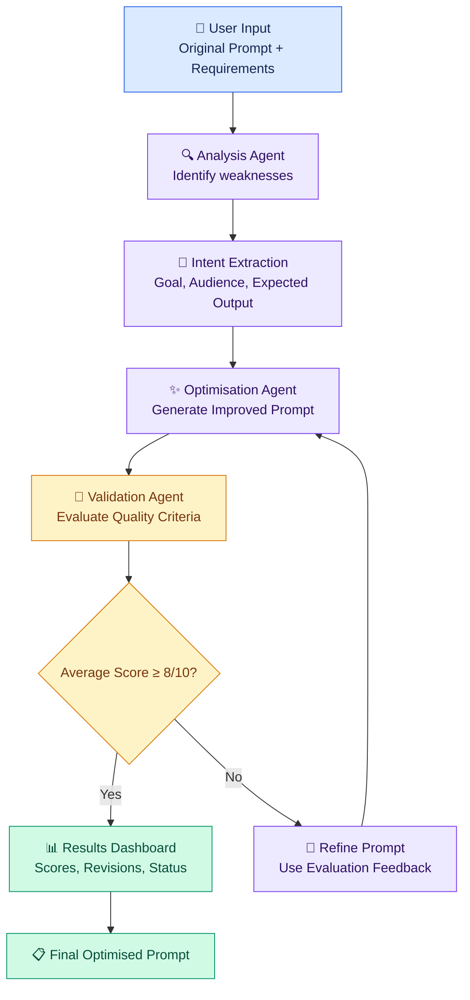
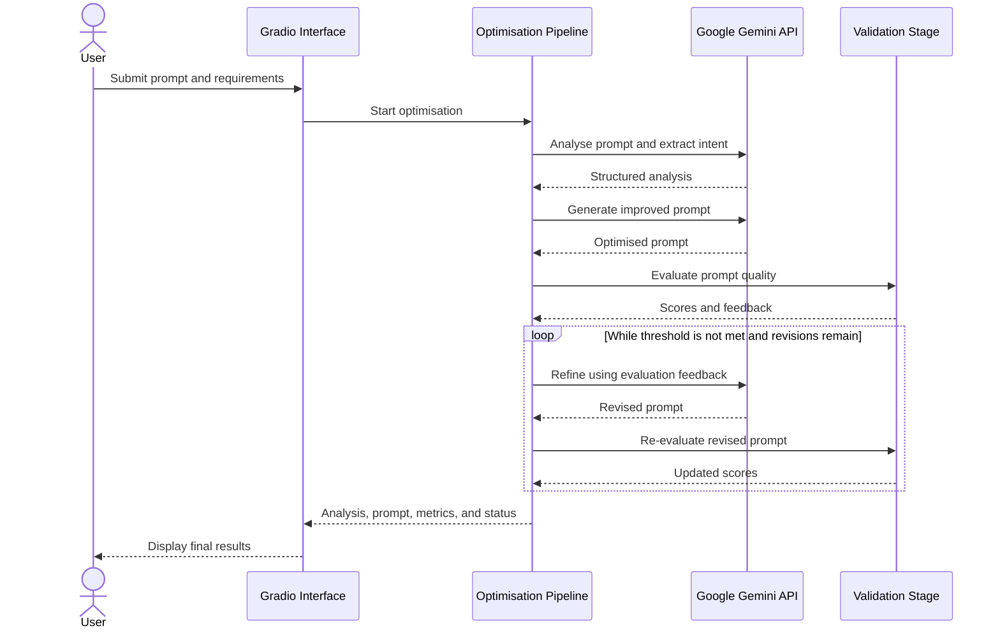
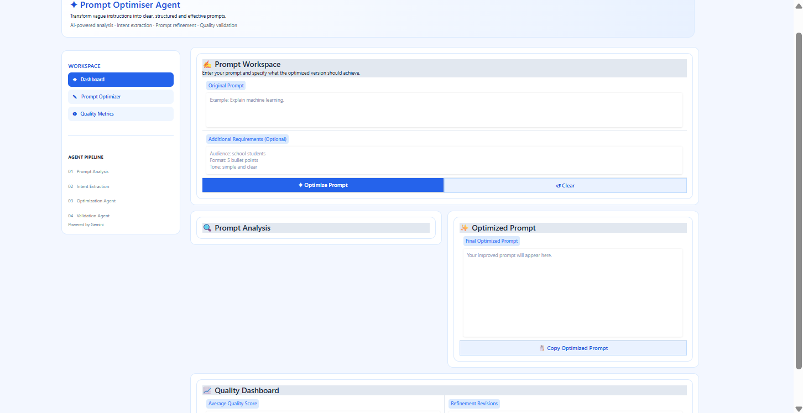
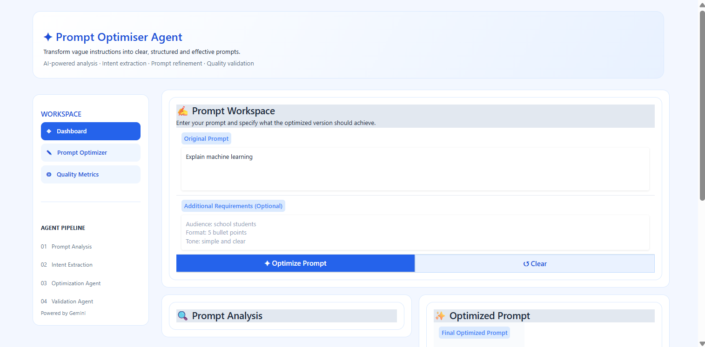
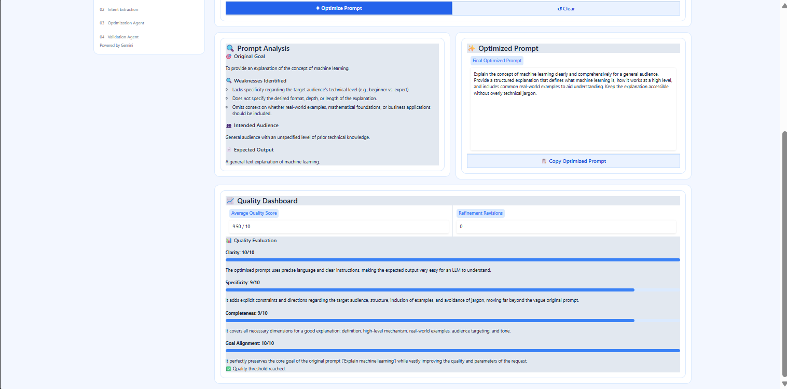
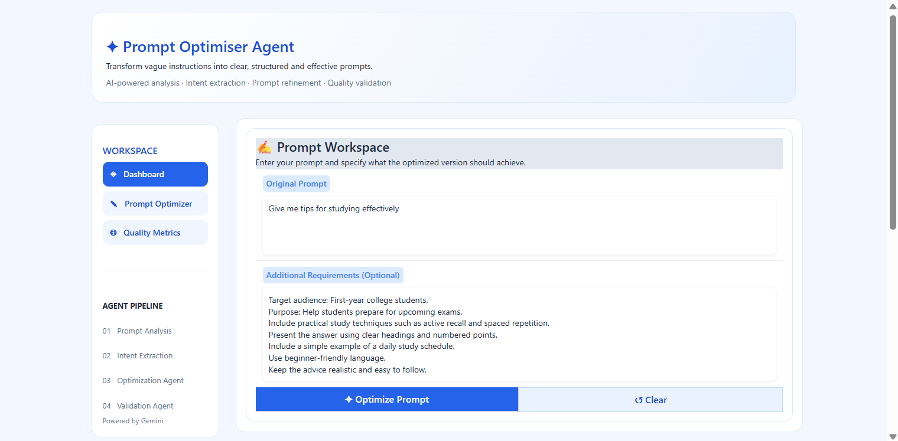
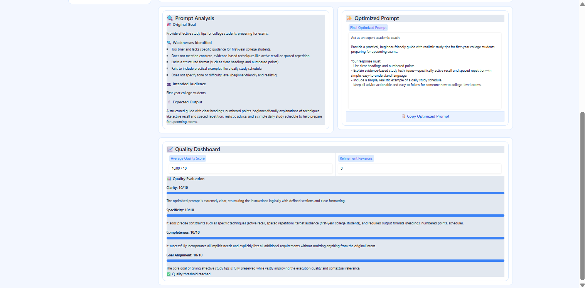

# ✨ Prompt Optimiser Agent

### An AI-powered system for analysing, optimising, validating, and refining natural-language prompts.

<p align="center">
  <strong>From vague instructions to clear, structured, goal-oriented prompts.</strong>
</p>

<p align="center">
  
  
  
  
</p>

<p align="center">
  <a href="https://github.com/VarshiniRameszh/Prompt-Optimiser-Agent">Repository</a> •
  <a href="#-key-features">Features</a> •
  <a href="#-system-architecture">Architecture</a> •
  <a href="#-installation-and-setup">Installation</a> •
  <a href="#-usage">Usage</a>
</p>

---

## 📌 Project Overview

The **Prompt Optimiser Agent** is an AI-powered application designed to improve the quality of user-provided prompts before they are used with a large language model (LLM).

Vague instructions often lead to generic or incomplete responses. This project addresses that challenge through a structured workflow that analyses the original prompt, extracts user intent, generates an improved prompt, and evaluates its quality against defined criteria.

The application integrates **Google Gemini** for language understanding and generation, **Python** for orchestration and processing, and **Gradio** for an interactive web interface.

Rather than directly rewriting an input without analysis, the system uses distinct processing stages to make prompt improvement more systematic and measurable.

## 🎯 Objectives

- Identify ambiguity, missing context, and weaknesses in user prompts.
- Extract the original goal, intended audience, and expected output.
- Generate clear, specific, structured prompts while preserving user intent.
- Evaluate the improved prompt against multiple quality criteria.
- Refine the prompt when its validation score does not meet the required threshold.
- Provide an accessible interface for interacting with the optimisation pipeline.

## 🚀 Key Features

| Feature | Description |
|---|---|
| 🔍 Prompt Analysis | Examines the original prompt and identifies potential weaknesses. |
| 🎯 Intent Extraction | Determines the user's primary goal, intended audience, and expected output. |
| ✨ Prompt Optimisation | Generates a more precise and structured version of the original prompt. |
| 🧪 Quality Evaluation | Evaluates clarity, specificity, completeness, and goal alignment. |
| 🔄 Iterative Refinement | Uses evaluation feedback to guide additional optimisation attempts. |
| 📊 Validation Metrics | Displays individual quality scores, an average score, revision count, and validation status. |
| 🖥️ Interactive Dashboard | Provides input fields and result panels through a Gradio interface. |
| 🔐 Environment-Based Configuration | Loads the Gemini API key from a local environment file instead of hardcoding it. |
| 🛡️ Response Validation | Checks model output, parses JSON responses, and handles missing or malformed data. |

## 🏗️ System Architecture

The application is organised as a sequence of logical processing stages.



### Processing Pipeline

**Stage 1 — Input Processing**

The user supplies an original prompt and may optionally specify requirements such as audience, tone, output format, or length.

**Stage 2 — Analysis and Intent Extraction**

Gemini analyses the prompt and returns structured information describing:

- Original goal
- Identified weaknesses
- Intended audience
- Expected output

The analysis is represented as JSON so that subsequent processing stages can access the fields programmatically.

**Stage 3 — Prompt Optimisation**

The optimisation stage uses the original prompt, additional requirements, and analysis results to generate an improved prompt. The user's original objective and stated constraints are preserved.

**Stage 4 — Quality Validation**

The validation stage evaluates the improved prompt using four criteria:

- **Clarity** — Are the instructions understandable?
- **Specificity** — Are the requested details sufficiently precise?
- **Completeness** — Are important requirements and context included?
- **Goal Alignment** — Does the prompt preserve the user's intended objective?

**Stage 5 — Feedback and Refinement**

The evaluation results guide further refinement when the prompt does not reach the configured quality threshold. The application tracks revisions and reports whether validation passed or the revision limit was reached.

**Stage 6 — Result Presentation**

The dashboard displays the prompt analysis, optimised prompt, evaluation scores, average score, revision count, and validation status.

> **Note:** The quality scores are model-generated evaluations. They are useful for structured feedback, but they are not an independent guarantee of correctness.

## 🧠 Agent Workflow

The following sequence illustrates the responsibilities of the main logical components.



## 🛠️ Technology Stack

| Technology | Role in the Project |
|---|---|
| Python | Core application logic and pipeline orchestration |
| Google Gemini API | Natural-language analysis, generation, and evaluation |
| `google-genai` | Python SDK for communicating with the Gemini API |
| Gradio | Interactive web-based user interface |
| `python-dotenv` | Loads configuration values from a local `.env` file |
| JSON | Structured exchange and validation of analysis and evaluation results |
| Regular expressions | Helps remove Markdown code fences before parsing JSON responses |
| Git and GitHub | Version control and source-code hosting |

## 📂 Project Structure

```text
Prompt-Optimiser-Agent/
│
├── app.py                  # Application logic and Gradio dashboard
├── requirements.txt        # Python package dependencies
├── .env.example            # Example environment configuration
├── .gitignore              # Excludes secrets and generated files
├── README.md               # Project documentation
│
├── .env                    # Local API credentials (not committed)
├── .venv/                  # Local Python virtual environment (not committed)
└── Copy_of_Prompt_Optimiser_Agent_Development.ipynb
                            # Development notebook, if retained locally
```

The `.env`, `.venv/`, and development notebook may remain local and need not be committed. The public repository should contain only files intended for sharing.

## ⚙️ Installation and Setup

### Prerequisites

- Python 3.10 or a compatible newer version.
- Git installed on your system.
- A Google Gemini API key.
- Internet connectivity for API requests.

### 1. Clone the Repository

```bash
git clone https://github.com/VarshiniRameszh/Prompt-Optimiser-Agent.git
cd Prompt-Optimiser-Agent
```

### 2. Create a Virtual Environment

A virtual environment isolates the project's dependencies from other Python applications.

**Windows — PowerShell**

```powershell
python -m venv .venv
.\.venv\Scripts\Activate.ps1
```

**macOS / Linux**

```bash
python3 -m venv .venv
source .venv/bin/activate
```

### 3. Install Dependencies

```bash
python -m pip install --upgrade pip
pip install -r requirements.txt
```

### 4. Configure the Gemini API Key

Create a local `.env` file using the example configuration.

**Windows — PowerShell**

```powershell
Copy-Item .env.example .env
```

**macOS / Linux**

```bash
cp .env.example .env
```

Open `.env` and replace the placeholder with your own Gemini API key:

```dotenv
GEMINI_API_KEY=your_actual_gemini_api_key
```

The application reads this value using `python-dotenv` and passes it to the Gemini client.

**Security requirements**

- Never commit `.env` to GitHub.
- Never hardcode API keys into `app.py`.
- Never include a real API key in `README.md`, screenshots, notebooks, or public issues.
- Keep `.env.example` limited to placeholder values.

### 5. Launch the Application

```bash
python app.py
```

After startup, open the local URL printed in the terminal by Gradio. The address is commonly `http://127.0.0.1:7860`, depending on the application's launch configuration and port availability.

## 💻 Usage

1. Launch the application.
2. Enter the original prompt in the prompt workspace.
3. Optionally provide additional requirements such as audience, tone, length, or format.
4. Select the optimisation button.
5. Review the prompt analysis and generated prompt.
6. Inspect the quality scores and validation status.
7. Copy and reuse the improved prompt in a suitable LLM application.

### Example Input

**Original prompt**

```text
Explain machine learning.
```

**Additional requirements**

```text
Audience: Beginners
Tone: Simple and educational
Format: Use headings and practical examples
```

### Expected Output Characteristics

The generated prompt should communicate:

- The intended audience and level of explanation.
- The specific concepts to cover.
- The desired structure and output format.
- The requirement to include suitable examples.
- The original learning objective.

*The actual output is generated dynamically by Gemini and may vary between requests.*

## 📸 Screenshots

### Main Dashboard



### Test Case 1: Machine Learning

**Original Prompt:** Explain machine learning.





### Test Case 2: Study Tips

**Original Prompt:** Give me tips for studying effectively.





## 🧩 Implementation Highlights

### 1. Secure Configuration

The API key is loaded from the local environment rather than embedded directly in the source code.

```python
import os
from dotenv import load_dotenv
from google import genai

load_dotenv()

api_key = os.getenv("GEMINI_API_KEY")

if not api_key:
    raise ValueError(
        "GEMINI_API_KEY is missing. "
        "Please configure your local .env file."
    )

client = genai.Client(api_key=api_key)
```

This separation improves configuration management and reduces the risk of accidentally exposing credentials in source control.

### 2. Structured Model Responses

The analysis stage requests a structured response so its results can be consumed by the next processing stage.

```json
{
  "original_goal": "Understand the fundamentals of machine learning",
  "weaknesses": [
    "The target audience is unspecified",
    "The desired output format is unclear"
  ],
  "intended_audience": "Beginners",
  "expected_output": "A structured explanation with examples"
}
```

*Illustrative example only. The actual values are generated by the model.*

Structured responses help separate analysis from prompt generation and simplify downstream validation.

### 3. Quality Evaluation

The validation component considers multiple dimensions rather than relying only on the apparent length or wording of the generated prompt.

| Criterion | Evaluation Focus |
|---|---|
| Clarity | Understandability of the instructions |
| Specificity | Precision of the requested task |
| Completeness | Coverage of relevant requirements |
| Goal Alignment | Preservation of the user's objective |

The application calculates an average quality score and uses a configured threshold of **8/10** to determine whether the prompt meets its validation target.

### 4. Error Handling and Response Parsing

Model responses may contain Markdown code fences, incomplete output, or malformed JSON. The application includes response checks and JSON parsing logic to handle these cases more safely.

The implementation also checks for empty model responses and missing required fields before using analysis results.

## 🔐 Security and Responsible Use

- API credentials are supplied through environment variables.
- The `.gitignore` file excludes local secrets and virtual-environment files.
- Model-generated analysis and quality scores should be reviewed rather than treated as guaranteed facts.
- Users should avoid submitting confidential or sensitive information unless they understand the relevant service's data-handling policies.
- Prompt optimisation should preserve the user's legitimate objective and must not be treated as a substitute for domain-specific verification.

## 🔭 Future Enhancements

Potential extensions to the project include:

- A configurable library of prompt templates for different tasks.
- Support for selecting optimisation strategies by use case.
- Side-by-side comparison of original and optimised prompts.
- Export of optimisation results to Markdown or JSON.
- A history of prompts and evaluation results.
- Automated regression tests for parsing, validation, and workflow logic.
- More systematic evaluation using fixed test prompts and repeatable benchmarks.
- Support for additional LLM providers through a configurable model interface.

These are proposed enhancements, not claims about currently implemented functionality.

## 🎓 Project Context

Developed as an **Agentic AI project** to explore structured prompt engineering, LLM orchestration, iterative feedback, and interactive AI application development.

## 👩‍💻 Project Contributors

This project was developed collaboratively as part of an Agentic AI project.

- **Varshini Rameszh** — [@VarshiniRameszh](https://github.com/VarshiniRameszh)
- **Thanisha** — [@thanisha2696](https://github.com/thanisha2696)

## 📄 License

No license has been specified yet. Unless a license is added to the repository, others should not assume that they have permission to redistribute or reuse the project's code.

---

<p align="center">
  <strong>Prompt Optimiser Agent</strong><br/>
  <em>Analyse. Optimise. Validate. Refine.</em>
</p>
